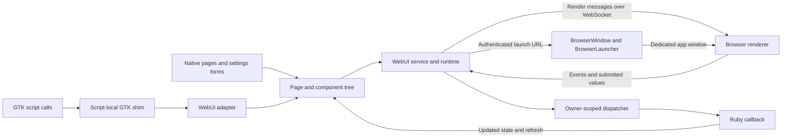

# WebUI architecture and integration

WebUI supplies the graphical launcher, native script interfaces, and a bounded
GTK compatibility layer. Both native and compatible GTK script interfaces use
the same component contract, renderer, and window lifecycle. Core WebUI is
independent of the compatibility layer and does not require the GTK gem.

This guide describes the development tree after PR #38, at `d3e41e71`, rather
than a released EO distribution. The [review-readiness record](webui-review-readiness.md)
tracks merged work, acceptance limits, open items and proposed extraction
boundaries. [Fixture provenance](../spec/fixtures/webui/README.txt) identifies
the frozen script sources used for regression checks.

The authoritative host/browser contract is
[`Contract::VERSION`](../lib/webui/contract.rb), currently **2.21.0**. It is an
internal compatibility version, not a Lich or script release number. Versioned
feature notes below describe when capabilities were introduced, not a second
current contract. Ruby validation and browser handling must agree on the same
capabilities.

## Rendering and event flow



The main responsibilities are:

| Layer | Responsibility | Source |
| --- | --- | --- |
| Author API | Register, render, open and close owner-scoped pages | [WebUI API](../lib/api/webui.rb), [WebUI facade](../lib/webui.rb) |
| Presentation | Build declarative component trees, forms and reusable compositions | [TreeBuilder](../lib/webui/tree_builder.rb), [SettingsForm](../lib/webui/settings_form.rb), [ListSettingsForm](../lib/webui/list_settings_form.rb) |
| Compatibility | Translate supported script-local GTK calls into the shared contract | [ScriptScope](../lib/common/script_scope.rb), [GTK shim](../lib/common/script_scope/gtk/) |
| Contract | Define and validate properties, events and child relationships | [Contract](../lib/webui/contract.rb), [Validator](../lib/webui/validator.rb) |
| Runtime | Register pages, track viewers, dispatch callbacks and manage modals | [Service](../lib/webui/service.rb), [Runtime](../lib/webui/runtime.rb) |
| Window host | Launch and monitor browser processes and retain window geometry | [BrowserWindow](../lib/webui/browser_window.rb), [BrowserLauncher](../lib/webui/browser_launcher.rb), [WindowGeometryStore](../lib/webui/window_geometry_store.rb) |
| Renderer | Paint shared controls and send user events and submissions | [JavaScript](../lib/webui/assets/app.js), [CSS](../lib/webui/assets/app.css) |

Scripts retain ownership of their calculations, defaults, ordering, persistence,
validation and cancellation behavior. Presentation helpers do not supply those
policies. Native consumers use WebUI directly; they do not pass through the shim.
The compatibility layer is a migration bridge with a supported subset of GTK,
not a permanent replacement implementation of GTK.
Unsupported interfaces require a native conversion or a separately designed
contract extension. Visual translation should remain a close match to the
original GTK interface unless a documented architectural boundary requires a
declared omission or approximation. Shared controls must remain useful to native
consumers; script IDs, business rules and per-script layout branches do not
belong in the shim or renderer.

Graphical startup uses the native WebUI launcher. `--no-gui` and its legacy
alias `--no-gtk` suppress that launcher; they do not select a native GTK backend
or disable default-gem checks. macOS requires the bundled AppKit/WebKit helper;
Windows/Linux require a supported Chromium browser as described below.

### Script dependency boundary

`Script` activates the compatibility scope before evaluating either trusted or
label-based scripts. Within a running script, `require 'gtk2'` and
`require 'gtk3'` (including `.rb` spellings) resolve to that already-loaded shim
and return `false`. They never activate an installed native GTK gem. Supported
widgets still resolve lexically through `ScriptScope`; no global `Gtk` is added.

The plugin guards Ruby's `require`, `require_relative`, and `load`, including
explicit `Kernel` calls and calls in required helpers. Recognizable native GTK
subloads and GTK-stack dependencies are refused with script, operation, feature
and source attribution. Outside script ownership, even the GTK entrypoint aliases
are refused. Ordinary dependencies retain Ruby loading and relative-path behavior.
This process-wide dependency guard is installed by the script plugin; core WebUI
does not depend on the shim. It is not a sandbox against arbitrary Ruby, renamed
native binaries, or direct FFI calls. Native GTK loading, event loops, and fallback
are unsupported; installed GTK gems do not extend the compatibility contract.

### Progress and overlay compatibility (contract 2.19.0)

`ProgressBar#fraction=` shares `set_fraction` validation and clamping. `show_text=`
and `show_text?` control only the bar's own text, hidden by default. `text=`/`text`
retain a bounded literal string while hidden; nil displays a rounded percentage
when text is enabled. These map to the existing optional progress `label` property.
Width requests use the existing minimum-width property, and the HTML trough fills
its allocation so an aligned overlay label remains over the bar.

All core progress controls share the same trough, border and default accent fill,
whether their script CSS is recognized or omitted. A recognized color overrides
only the fill. Explicit width/height allocations apply independently; the default
track height is 18px. An enabled label occupies its normal line above the track
within the requested height. Indeterminate controls retain an unknown value and
use a moving segment, held still when reduced motion is requested.

`Overlay#add_overlay`, `set_overlay_pass_through(child, boolean)` and
`get_overlay_pass_through(child)` retain owner-local layer relationships. Overlay
children honor horizontal and vertical alignment. The core overlay child placement
`pass_through` disables pointer hit testing for that subtree, including nested
controls, without making it keyboard-disabled or inert. The explicitly approved
`Adapter#set_overlay_pass_through(parent, child, boolean)` validates live updates,
preserves handles/bindings/viewer drafts and rolls back placement on publication
failure. Detachment clears the flag; child and owner destruction release metadata.

Progress controls now accept the existing opt-in `pointer_events`/`pointer_press`
contract, with the same bounded payload and event validation as other pointer
surfaces. `Gdk::Event::BUTTON_PRESS_MASK` aliases the supported EventMask constant;
other native event families remain unsupported. `Window#decorated=`/`decorated?`
map to the existing `presentation.borderless` request and preserve other presentation
properties. Native WebKit applies it; ordinary browsers cannot remove OS chrome.
The getter reports the requested state, not a claim of browser enforcement.

The pinned manatimer fixture covers unchanged setup, provider, countdown,
right-click and cleanup code, including restoration lines 76–79 with saved
position supplied by the fixture. Missing saved position and the source clamp's
ignored monitor origin remain script defects. Red/green CSS pulse cues remain
omitted; no CSS grammar, game logic, GLib scheduler or real GTK was added.

### Best-effort monitor geometry and named cursors (contract 2.20.0)

`Service#monitor_geometry(owner:, viewer: nil, target: :active, point: nil)` and
`Adapter#monitor_geometry(target: :active, point: nil)` share one selection rule.
Targets are active, primary or point (a two-integer signed desktop coordinate).
Results carry x/y/width/height, source (`native` or `browser`) and a fallback flag;
unavailable results contain source `unavailable` and fallback true without a
fabricated rectangle. A missing requested monitor falls back to active, primary,
then the first available monitor. No pointer/device operations are exposed.

Before a viewer is attributed, macOS queries the bundled AppKit helper, Windows
queries Forms/Win32 foreground-window geometry through PowerShell, and Linux
optionally queries XRandR. Missing/restricted providers return unavailable;
helper output and lifetime are bounded. XRandR does not identify the active
window, so active selection is explicitly a fallback. Authenticated configure
events carry bounded per-viewer monitor hints: WebKit reports AppKit topology;
ordinary browsers report their available current screen only. An explicit viewer
never reads another viewer's data or falls back to the server's desktop. Hints
are discarded on detach/disconnect and are not persisted as window settings.

The shim projects only `Display.default.default_screen`, point selection and
geometry lookup, and `Display.default.primary_monitor.geometry`. Rectangles and
tokens are owner-bound. Unavailable geometry uses the already-declared nominal
1024x768 initial sizing hint with one attributed notice. macOS clamps requested
positions to an available visible screen; other hosts retain their existing
best-effort placement. Exact multi-monitor placement is not guaranteed, and
script-origin arithmetic is not rewritten.

All shared components accept `cursor_hint: default|pointer|cell|copy`. Hints
inherit within a widget subtree; a nested hint overrides its ancestor. The shim
supports `Gdk::Cursor.new(name, display: ...)`, `new_from_name(display, name)`,
`:hand2`/`CursorType::HAND2` aliases, and `widget.window.set_cursor`/`cursor=`.
Nil removes a hint without replacing handles or input state. Unknown bounded
names use default with one attributed notice; malformed arguments, foreign
owners and retired widgets/sessions refuse. The window facade is cursor-only:
native handles, seats/devices, pointer polling, grabs and warping still refuse.

Acceptance covers full cached manatimer setup/update/cleanup and the exact
gemstonev geometry/cursor and highlight-manager cursor-helper excerpts. It does
not establish whole gemstonev/highlight-manager or live-game compatibility.
Native WebKit and Chrome checks pass locally; Windows/Linux native behavior and
physical multi-monitor arrangements remain unverified. Native map is already
converted; xnarost gets no shim expansion, and sea-charts is a separate native
conversion candidate.

### Script bindings and helpers

Each script binding has independent local variables. Trusted scripts evaluate
inside `Lich::Common::ScriptScope`: bare top-level methods and constants live in
that shared script scope, not on `Object` or `Lich::Common`. They are not isolated
per script. An absolute lookup such as `::MyHelper` does not find a script-scope
constant, and explicitly reopening a global class does not import script helpers.
Label-based scripts retain their own receiver for instance methods while sharing
the lexical constant boundary. This differs from the former global binding;
it is not a Ruby sandbox.

New script-owned nested classes and modules receive script helpers. For inherited
classes, real superclass methods take precedence and only declared public script
helpers are forwarded; the module's administrative methods are not forwarded to
instances. Assigning an existing core module or class to a script constant is an
alias, not permission to modify its ancestors or inject helpers into core objects.

Destroy callbacks run independently. A script error in one handler is logged and
does not skip later handlers or sibling-window cleanup. Fatal VM failures are not
treated as recoverable callback errors. Repeated destruction remains idempotent.

### Scheduled script work

`GLib::Timeout.add(milliseconds)`, `Timeout.add_seconds(seconds)`, `Idle.add`
and `Source.remove(id)` are bounded, script-local scheduling facades. They accept
the cached positional interval/block (including `&Proc`) forms. They do not load
native GLib, replace Ruby's `::Timeout`, or expose priorities, MainLoop, IO watches
or other GLib APIs. Unknown constants/methods retain attributed refusal.

Core consumers can capture `WebUI.callback_scheduler(owner:)`, whose handle exposes
`schedule(interval_ms) { ... }`, `cancel(id)` and `cancel_all`. The handle retains
the original host; it cannot resurrect a stopped service. `cancel_all` removes
only registrations made through that handle. IDs are positive, monotonic and
not reused within a host; canceling another owner's live ID is refused. Removing
an unknown, finished or already canceled ID returns false.

One lazy host timing worker uses monotonic deadlines and enqueues work on the
existing owner dispatcher. It belongs to the default thread group, not the first
registering script. Callbacks never run on that timing worker. Intervals are
integers from zero through 4,294,967,295 milliseconds; seconds convert into that
same bound. Zero-timeout and idle work defer with a 1ms fairness floor, without
promising GLib idle priority or exact timing. Limits are 256 live sources per
owner and 4,096 per host. Queue overflow retires the refused source with a diagnostic.

Truthy callback results repeat; false/nil or callback failure retires the source.
Rearming occurs after completion, so callbacks cannot overlap or accumulate
missed ticks. Cancellation is rechecked before execution; running work may finish
but cannot rearm. Owner/service shutdown closes admission and cancels sources.
Shim callbacks preserve registration-time script/viewer context, Script pause
behavior, model batching and the existing callback error boundary. Session cleanup
cancels its own handle's sources without canceling separate native registrations.

Cached repository v2.76 acceptance covers the unchanged ten-second download-button
timer, cancellation/replacement and captured `Script.start`, without downloading.
Sail2's original config branch has a startup race: it schedules window creation
while the window is nil, then immediately waits for nil and exits. The negative
case remains; positive setup/save evidence explicitly substitutes a test-only
`:pending` sentinel. Its setup, inherited sensitivity, save and original Close
callback now pass. This does not repair the startup race or claim sailing-loop acceptance.

### Inherited sensitivity and retained window visibility (contract 2.21.0)

Layout containers and pages accept `disabled`. Descendant controls inherit that
state in the renderer; event intake refuses interactions through disabled ancestors.
Lifecycle events remain accepted. Re-enabling a container preserves each child's
own setting and input values. Shim `sensitive?` reads the local setting;
`is_sensitive?` reads effective sensitivity through its parents.

`presentation.hidden` is a boolean request through the existing shared presentation
record. Shim `Window#hide` keeps the page, handles and inputs alive; `show` reveals
the same window. Hiding before first show does not publish a page. Destroy remains
terminal. macOS hides/reveals the owned NSWindow; Windows uses the retained,
PID-checked Chromium HWND and ShowWindow without requesting focus. Normal renders
do not repeatedly reveal a minimized window. Windows behavior has provider-test
coverage; live native verification here is macOS only. Ordinary browser/Linux
hosts hide page content and record a presentation degradation because browser
chrome cannot be hidden. Hidden pages suppress user interactions but keep lifecycle
and scheduled callbacks alive so scripts can show them again.

### Queued script work

`Gtk.queue` defers its block through `WebUI.callback_queue(owner:)`, which captures
the current host and submits to its existing owner dispatcher. It returns
`:queued` on admission, not the block result or a GLib timer ID. It returns `nil`
for ordinary work submitted during script teardown; a stopped host or full queue
refuses ordinary submissions.
The shim does not create an additional worker queue or a native event loop.

Accepted blocks execute sequentially in owner enqueue order alongside native UI
callbacks. They are not coalesced; a nested submission goes to the tail rather
than executing inline. Different owners run independently. No exact delay,
cross-script ordering, or browser-paint completion is promised. A block must not
wait for another callback on the same owner or synchronously await a modal;
use the existing asynchronous response callbacks instead.

The worker adopts the calling Script's ownership and respects its pause/stop
state. Ordinary legacy queue exceptions are reported without aborting later
blocks. An unhandled `BuilderError` is deliberately different: it retires that
owner's UI and requests asynchronous script termination, as detailed below.
Pending work is canceled on owner termination, and a retained queue handle
cannot restart a stopped host. Full dispatcher shutdown closes admission before
collecting workers, including owners that have not previously submitted work.

There is one cleanup exception: a `before_dying`/`Script.at_exit` handler may
call `Gtk.queue` on its existing session. Script has already stopped its ordinary
workers, so this block (including nested cleanup) executes inline under the shim
lock on that owner's cleanup thread and returns `:queued`. Existing scripts may
therefore queue their geometry reads/destruction and wait for completion without
deadlocking teardown. This does not reopen the dispatcher, create a session, or
allow unrelated late work. Closed sessions refuse all further submissions.
Compatibility failures retain their rejected class/operation in queue diagnostics;
arbitrary exception messages are not copied into those diagnostics.

The shim bounds progress fractions to the displayed 0–1 interval, including
infinite values. A NaN fraction retains the previous display value and emits one
compatibility notice per session because WebUI cannot transport NaN. Script
calculations are unchanged; native WebUI's numeric validation remains strict.

## Window hosting and lifecycle

On macOS, `BrowserLauncher` uses `OS.mac?` to select an AppKit window containing
Apple's WKWebView. Windows and Linux retain dedicated Chrome app windows,
with Edge also supported on Windows. An explicit browser executable
can still be supplied for browser comparisons. No Electron runtime is used.

The macOS helper runs as an accessory application (`LSUIElement` and AppKit's
accessory activation policy). Its windows remain interactive without adding
per-window application icons to the Dock or Cmd-Tab switcher. There is no
application menu bar; keyboard equivalents remain available inside the window.
Already-running helpers must be closed and reopened to adopt a changed build.
The helper and Ruby launcher must ship together: its first argument is a private
launch-file path, not an authenticated URL.

The experimental macOS helper is built with
`zsh lib/webui/native/macos/build.sh`. This requires Apple's installed command-line
developer tools and produces an ignored universal Intel/Apple Silicon app under
`lib/webui/native/macos/build/`, targeting macOS 14 or later. Normal launches never
compile or download anything. Distribution must supply this app; Developer ID
signing/notarization and testing on older macOS/physical Intel hardware remain
release work. The local build has only the linker's ad-hoc signature. A missing
helper is reported as a launch failure, rather than silently changing hosts.

On Windows, `WindowPresentation` uses `OS.windows?` and Ruby/Fiddle bindings to
`user32.dll` to apply topmost and whole-window opacity. No Windows helper build,
SDK, MSYS2 packages, or WebView2 runtime is needed for this approach. The Win32
mechanism follows [EO #1648](https://github.com/elanthia-online/lich-5/pull/1648).
Unlike its shared-profile title fallback (corrected by
[EO #1657](https://github.com/elanthia-online/lich-5/pull/1657)), this host discovers
only an unambiguous top-level Chromium window belonging to its isolated process.
Discovery is bounded and canceled on close. Each subsequent validated render
updates the same controller, which rechecks PID ownership before changing a
window. Native failures are logged. Actual Windows focus, opacity and cleanup
still require verification on Windows.

`Service` owns one `BrowserWindow` per registered page and one for the page selector
opened by `WebUI.open` without a page. Service shutdown closes both. Repeated opens
reuse that ownership. Chrome/Edge processes have isolated temporary
profiles; their exit monitors remove the profiles. The macOS helper uses a
nonpersistent WebKit data store. Closing one page acts
on its owned process, not the user's ordinary browser or another page's window.
These monitors run inside Lich. A forced process kill or fatal crash can leave
host windows and private temporary launch/profile directories behind; there is
no parent-death watchdog or startup cleanup sweep. Disconnected windows continue
retrying their connection. Normal script termination and game exit use the
owned-window cleanup path described above.

Geometry precedence is explicit caller geometry, then saved geometry where the
page does not own configure handling, then the page's default size and position.
The geometry store is scoped by game and character when that context is available.
Pages with configure handlers own their geometry policy; the host neither restores
nor saves their geometry. This includes shim windows, whose ephemeral page IDs
must not accumulate unused host geometry files. Script geometry reads and existing
script-owned persistence remain unchanged. Older unused files are not deleted.
Browser content dimensions and OS-window dimensions are distinct; programmatic
window positioning and resizing remain subject to browser and platform behavior.
The AppKit host maps `presentation(always_on_top: true)` to normal window level
plus one, without cycling focus. Setting it false restores normal level. On-top
windows stay above ordinary windows in the current Space and do not follow the
user to other desktops or another app's full-screen Space. Borderless
windows remain closable with Cmd-W. Windows uses
`SetWindowPos(HWND_TOPMOST/HWND_NOTOPMOST, ... SWP_NOACTIVATE)` for the same
request, preserving keyboard focus in the frontend. Alt-F4 closes its windows.
The shim retains `Gtk::Window#keep_above=`
in the page's presentation property, validated by the same schema as native
presentation facilities; window presentation adds no adapter operation. Windows
Chrome/Edge still do not support the borderless request: Chromium draws its own
title bar. Linux retains the existing browser limitations.

The macOS host applies opacity with `NSWindow.alphaValue`; Windows uses
`SetLayeredWindowAttributes` with `LWA_ALPHA`. Native opacity affects the entire
OS window, not just its HTML content. The renderer suppresses its CSS fade when
the macOS bridge or the owned Windows host handles opacity, avoiding a second
multiplication. Other browser hosts retain their existing content-only fade.
An absent opacity request restores 100%; an absent topmost request restores
normal stacking. These properties do not alter a script's saved preferences.

The injected macOS bridge implements ordinary window resize/move operations
and supplies native outer dimensions and desktop coordinates to the existing
geometry reporters. Only the requested root controls the native window;
in-window dialogs cannot change its level or title. Navigation and native bridge
messages are limited to the original loopback origin and main frame. The helper
has no file-reading, shell-execution or arbitrary native-call bridge.

Owner termination first refuses new pages, windows and modals for that owner,
then cancels modals, revokes file routes, shuts down callback dispatch,
unregisters pages, and destroys viewer state. A restarted script has a new owner
identity. Completion-callback failures are logged without preventing remaining
callbacks or cleanup; full service shutdown also cancels pending modals. Explicit
window closure is distinguished from a temporary transport disconnect. Ordinary
disconnect retains a bounded 60-second resume window; repeated attachment to the
same page on an occupied connection is rejected.
An explicit detach closes the authenticated attachment even if a newer render
has overtaken the viewer, including an in-window modal without OS geometry.
This does not relax generation checks for component events or submissions.

Close and detach callbacks receive a temporary snapshot of the last validated
viewer state, so legacy close/save handlers can still read inputs after the live
attachment is removed. The shim commits those inputs before `delete_event`;
callback completion or cancellation releases the snapshot. An owned OS window
exiting without `pagehide` uses its sole retained viewer when available; it does
not guess among multiple viewers. This does not add unsupported GTK dialogs.
Outgoing frames similarly use one captured render and its viewer values, keeping
component IDs, bindings and generation consistent during concurrent refreshes.
Late refreshes cannot restore diagnostic records for unregistered pages.

Modals reapply their declared `no_viewer` policy when the last active viewer
leaves: `abort` cancels, `default` selects the declared response, and `wait`
remains pending. Resumable disconnected attachments are not active viewers.
There is no new user-response deadline. A settings form whose host cannot open
its window cancels immediately instead of leaving its script waiting.
The shim's supported informational OK dialog uses the existing wait policy so
opening it before the first viewer attaches does not silently cancel it. Parent
destruction or owner shutdown cancels that pending dialog; callback code still
must use its asynchronous response handler rather than blocking the dispatcher.

## Script-owned models and viewer-owned tables

The GTK compatibility layer supports bounded `ListStore` and `TreeStore` models
with String, Integer, Float and boolean columns. Models belong to one script
session and may feed several views in that session. Model updates validate all
attached projections before publishing; a value that fits a table but exceeds a
ComboBox label limit is rejected without partially updating those views.
String columns preserve `nil` as an absent value, matching GTK; table cells and
combo labels display it as empty text without changing the stored value. Sorting
compares absent and empty strings equally and preserves their insertion order.
Other scalar columns still reject `nil`. Model strings are limited to 65,536
characters, independently of the receiving control's display limits. Hidden
metadata columns are not serialized into table cells. Plain-text content also
accepts up to 65,536 characters so a selected record can display its complete
description; input fields, tooltips and ComboBox label limits remain unchanged.
No text is silently truncated. Rejected model assignments report the column,
expected/actual type, string length and limit without logging cell contents.
Replacing a view's model detaches its old observer. Window/widget destruction
detaches observers without destroying a model that another view still uses.

Model lookups use row-identity and parent/children indexes. Structural changes
rebuild those indexes; scalar edits invalidate ordering caches without rebuilding
row indexes. Sibling ordering and path positions are cached for that model
revision. Equal sort values retain explicit insertion
positions, including prepend/insert. Rollback restores rows and sort state and
rebuilds the indexes under a new revision, so rejected projections cannot be
reused.

Within a `Gtk.queue` block or mapped signal callback, model changes are batched
under the existing owner dispatcher and session monitor. A model gets one rollback
snapshot per batch, while scalar/type/size checks and model reads remain synchronous.
At the boundary, all affected models validate their projections before any are
published. An invalid projection or raised exception restores pending model data,
sort order and removed iterators; new rolled-back row identities stay invalid.
Widget reads, writes and materialization flush pending models first, preserving
their synchronous interaction with script code. Changes already flushed at such
a barrier are committed; later failures roll back only the pending batch. Direct
model calls outside these callbacks retain immediate validation and publication.
Adapter publication is coalesced onto the same owner dispatcher after queued
construction, so long initialization cannot publish a partially initialized form
and turn its remaining default assignments into ambiguous viewer writes. No new
queue, worker, script-specific path or adapter-port operation is introduced.

Before a TreeView is materialized, model notifications validate column/editor
configuration and retained selection, expansion and cursor references without
projecting every cell. Model setters still enforce scalar, row-count and tree
depth bounds; ComboBox and cell-editor choice limits still reject incompatible
mutations. Materialized tables reuse their validated row projection when
publishing that batch. The shared table contract still receives complete row sets;
batching is internal and does not introduce incremental wire updates.

Rows have stable identities independent of their positional `TreePath`.
`TreeIter#next!` moves an independent handle and invalidates it at the end;
it does not overwrite stored rows. Removing a row removes its descendants and
advances the supplied iterator to the next sibling, returning whether one exists.
Other handles to removed rows become invalid. Insertions and built-in scalar
sorting change paths while preserving row identity. Tree sorting orders siblings,
not the entire flattened tree. Custom sort functions and filter/sort proxy models
are unsupported.

`TreeView` maps plain text, boolean toggles and closed choice editors onto the
shared `table` component. Selection modes are none, single, browse and multiple.
The browser supports tree expansion, keyboard row navigation, additive/range
selection, editable cells and row activation. An edited/toggled signal proposes
a change: the script's handler alone decides whether to mutate its model. Toggle
handlers receive the path and observe the old boolean; text/choice handlers
receive the path and proposed text. A rejected edit repaints the retained model
value. Event row identities resolve to current paths; a removed row cannot
silently redirect an old event to a replacement at the same position.

Selection, expansion and cursor state belong to each viewer, survive refreshes,
and lose only references to removed rows. Callbacks read their originating
viewer's state; terminal callbacks retain it for subsequent script reads and
closure. Programmatic updates after publication use the existing explicit
viewer attribution rules. They do not broadcast one viewer's selection to other
viewers. Model contents and model sort order remain shared between the model's
views. Column structure and renderer-to-model bindings are configured before
materialization; captions, resizing, widths and editor configuration may update
afterward. Starting a cell editor programmatically is unsupported.

`ComboBox` binds a real flat `ListStore`; `active_iter` returns an actual model
iterator. A chosen String column supplies labels, while stable row IDs preserve
duplicate choices. `ComboBox.new(true)` and `ComboBoxText` provide single-column
text convenience methods. Editable forms expose their entry through `child`,
using the combo's single input rather than a separately rendered Entry. Removing
the selected row clears that viewer's choice; unrelated choices and literal
free text survive model updates. `active = -1` explicitly clears selection.

Contract **2.12.0** adds generic table `headers`, viewer-scoped `expanded` and
`cursor` properties, browse selection, model-owned sorting, cursor events, and
an optional activation column. Existing nested row expansion defaults remain
accepted. Checkbox editors can be explicitly disabled. Selects optionally declare
an `empty_value` option and a `free_text_prefix` disjoint from option IDs. The
shim uses that encoding so literal entry text cannot collide with a row ID or
the blank-selection sentinel. Existing native consumers retain their previous
defaults. This is the internal host/browser contract version, not a Lich release.

Contract **2.13.0** adds optional table `search_column`, naming a displayed column.
Search is viewer-local, case-insensitive prefix matching over visible rows. Typing
on a focused row selects/focuses a match without editing the model. Backspace edits
the prefix, Escape clears it, and a 1.5-second pause starts a new prefix. Cell
editors and modified shortcuts keep their normal keys. Existing tables opt out
unless they declare this property; invalid column references are rejected.

Multiple renderers within one column, rich cell styling/markup, pixbuf
cells, arbitrary cell-data callbacks, coordinate hit testing, and arbitrary drag-and-drop
remain unsupported. Unsupported meaningful operations raise attributed errors;
they are not discarded or represented by empty placeholder widgets. This bounded
surface does not establish whole-script compatibility for consumers needing any
of those additional operations.

### Bounded Gtk::Builder XML

`Gtk::Builder` translates a supported subset of GTK 3 XML into the same
script-owned shim objects used by direct Ruby calls. It supports subclassing,
`add_from_string`, local `add_from_file`, `get_object`/`[]`, `objects`,
`builder_name`, and `connect_signals`. No Ruby is evaluated from XML. This is a
shim addition; subsequent interaction mappings reuse the shared controls described below.

Loads are isolated transactions. The parser checks syntax and all unmapped
property declarations before allocating objects, resolves construction
dependencies, populates and binds models, assembles children, then validates
component properties before publishing requested visible windows. Failed loads
detach new observers and destroy candidate widgets; previously loaded objects
and identifiers remain intact. IDs must be unique across successful additions.
References must resolve within the current document, including forward
references; binding an earlier document's object is deliberately unsupported so
a failed addition cannot mutate an existing graph. `objects` returns a snapshot
in XML order. `builder_name` retains declared IDs and supplies generated names
for anonymous objects; lookup uses declared IDs only.

`get_object` and `[]` raise `Gtk::BuilderError` for undeclared IDs, identifying
the script, requested ID and lookup operation and recommending native WebUI
conversion. This intentionally differs from GTK's `nil` return: Lich's
`NilClass#method_missing` extension can otherwise silently swallow the subsequent
widget operation. Scripts needing optional lookups must inspect the `objects`
snapshot explicitly. A failed lookup rescued by the script does not discard
previously loaded objects. If a Builder error escapes a `Gtk.queue` block, the
session closes that owner's windows, refuses subsequent queued work and requests
Lich's existing asynchronous script stop. Other script sessions are unaffected;
a partially initialized setup must not remain running without its close handlers.

The retained original `eloot` setup requests `exclusions_label`, which its XML does not
declare. The shim therefore refuses that lookup during tooltip initialization.
The source repair is to name the existing Exclusions label `exclusions_label`;
the converted native WebUI version is also an available migration path. Production GTK can continue past this
defect because of Lich's nil suppression, but the tooltip is never assigned.
The retained WebUI conversion builds the exclusions group directly and removes
the bad lookup; it also omits this help text, despite retaining the `(?)` caption.

The retained original `bigshot` setup has the same category of source defect:
its tooltip initializer looks up `boon_flee_from`, absent from its XML. The
converted version stores that unused tooltip in metadata instead. No widget is
fabricated and no nil-suppression behavior is added to the shim. XML preflight
success does not establish successful setup initialization or callback wiring.
Its source repair removes the obsolete tooltip assignment and replaces the
legacy `boon_flee_from` migration (which also looks up nonexistent `all:flee`)
with a one-time migration into the existing all/category/per-trait boon settings.
These script repairs are not implemented by the shim.

Acceptance tests retain both unchanged failure fixtures and separately labeled
corrected candidates. Exact, test-only substitutions in
`spec/support/webui_builder_source_repairs.rb` are applied after source digest
checks; an unexpected source shape fails rather than silently changing a repair.
Corrected eloot covers all twelve list add/delete handlers, scalar settings,
tipping-preview dispatch, dependencies, Close/save and destroy without save.
Corrected Bigshot covers scalar fields, text-area focus-out, boon choices and
legacy migration, profile load/new/overwrite/cancel/update, Close persistence and
destroy without save. Each has an independent Chrome interaction case.
Game catalogs, tip calculation/terminal formatting and persistence destinations
are isolated harness dependencies. These are setup/UI checks, not gameplay or
native desktop-window certification. The retained originals remain blocked;
accepting a future author repair requires checking that new source separately.

The explicit class/property mappings live in
[`gtk/builder.rb`](../lib/common/script_scope/gtk/builder.rb). They cover existing
boxes, grids/tables, frames, scrolling containers, paired notebook page/tab
labels, expanders, plain labels and entries, buttons/toggles/radios, adjustment
and spin controls, text buffers/views, separators, scalar stores, tree views and
single cell renderers, and combo boxes. Grid/table coordinates and box packing
use existing placement APIs. Tree selection and editable combo entry internal
children expose their owner's real objects. The combo's child is an actual Entry
with delegation attached, preserving exact-class checks while sharing one browser
input. Programmatic Entry writes emit `changed` after a valid value change,
including read-only fields; equal writes do not recursively emit. Stores accept typed scalar columns
and row data; nested rows require `TreeStore`. Unset string cells remain `nil`
for script reads, distinct from an explicit empty string; table cells and combo
choices display both as blank text. A renderer accepts one model
binding. Combo items have plain text labels and optional unique item IDs. Label
`style` attributes accept `normal` or `italic` through the existing typed text
property; `foreground` attributes accept six- and twelve-digit Pango RGB colors
through the existing shared color channels. Other Pango attributes, markup outside
the bounded forms below, caption styling and Builder stylesheet declarations
are unsupported. Translation
annotations retain literal source text; Builder does not perform localization.
Frame, expander and notebook captions copy their label text at load time, following
the existing shim container APIs; later edits to those label objects do not update
the copied captions.

CSS support is distinct from typed presentation properties. Builder does not
accept arbitrary stylesheets or CSS classes. Direct shim `CssProvider#load(data:)`
and positional `load_from_data(data)` recognize the bounded progress grammar in
[`gtk/style.rb`](../lib/common/script_scope/gtk/style.rb): bold label/trough/progress
rules, 22px trough and 20px progress minima, no background image, and a supported
fill color. The final color declaration may omit its terminating semicolon;
other declarations and their ordering remain bounded. Input remains limited to
8,192 characters. The [cached-cohort measurements](webui-css-decoration-acceptance.md)
cover 71 payloads across 33 pinned scripts: the largest literal is 4,742 characters
and the largest constructed sample is 6,230. The bound is retained; dynamic user
settings can still exceed it, so these samples are not a universal runtime maximum.
Recognized CSS translates validated values into progress effects or bounded label cues;
source CSS never reaches the browser. Other bounded strings are explicitly
omitted, including unrecognized colors, malformed CSS and URL/import declarations.
They are inert: no source CSS is retained, evaluated, fetched or sent to the browser.
The first omission logs `operation=css_decoration` once per script/session, with
script, receiver and call-site attribution (or `source=unknown` when unavailable).
The notice does not include source CSS. Loads, non-progress widget attachments,
screen attachments and class additions share this one omission notice.
The fact that the renderer itself uses CSS does not implement GTK selectors, widget
states or arbitrary native sizing semantics. Expanding that surface requires a
separate evidence-based decision, not script-name exceptions.

Every supported `Widget#style_context` returns a cached, owner-bound facade that
retains same-owner providers, including providers
attached before loading. `add_provider(provider, priority)` accepts APPLICATION
(600, also the omitted-argument default) or USER (800). Higher priority wins;
the most recently attached provider wins ties. Reattachment replaces that
provider's registration. Providers have explicit `unloaded`, `recognized` and
`omitted` states; `loaded?` is true for the latter two. Only providers with a recognized progress fill
contribute progress effects. Loads update every attached bar under the existing
session monitor. Recognized-to-omitted reloads reveal another recognized provider,
then authored values or theme defaults; stale fill/height effects are cleared.
An omitted provider can become recognized again on a later load. Non-string,
invalid/incompatible-encoding and over-limit input still refuses without changing
the previous state or presentation; unsupported call shapes still raise.
`remove_provider(provider)` reveals remaining providers, then the authored values
or default theme. Repeated removal of a same-owner provider is harmless.

Only local `ProgressBar` contexts apply recognized fill color and 24px height.
Progress rules attached to labels or other widgets remain inert. Authored progress values are
retained separately; explicit script writes made during styling win through
reload and removal. No style is copied to sibling labels. Contexts are limited to
64 distinct attached providers and the session's existing 20,000-component bound;
destroying a subtree detaches descendant contexts, and owner shutdown also clears
contexts on unattached widgets. Widget destruction and the window's retained
geometry snapshot use the same session monitor as provider reloads, so direct or
ancestor destruction cannot retire a handle during a style publication or leave
other attached bars stale. Cross-owner attachment/mutation and unknown style
methods refuse explicitly. Access to cached contexts also checks ownership and
lifetime. Cached-cohort sizes and source-derived acceptance are recorded in the
[acceptance report](webui-css-decoration-acceptance.md). Provider-load success alone
does not establish whole-script support;
unsupported widgets such as FlowBox and unrelated behavior still hard stop.

`Gtk::HeaderBar` composes existing boxes, labels and buttons into a client-area
title row. `set_custom_title`/`custom_title=`, `set_title`/`title=`, `pack_start`,
`pack_end`, `remove` and the boolean `show_close_button` setters preserve widget
identity and callbacks. `Window#set_titlebar`/`titlebar=` attaches that row before
content; replacement detaches the previous row without rebuilding the page or
destroying script-held widgets. Window content margins exclude the titlebar.
The Close action uses `Window#close` through the existing owner dispatcher,
preserving terminal input, delete-event vetoes, destroy handlers and cleanup.
This does not replace OS titlebar chrome or implement decoration layouts,
minimize/maximize controls, HeaderBar Builder XML, or arbitrary GTK CSS.

`Grid#attach` accepts bounded signed row/column origins and positive spans.
The shim retains logical coordinates and uniformly rebases negative origins into
positive WebUI placements, including live insertion/removal/destruction. The
owner-approved `Adapter#layout_grid(parent, columns:, placements:, expand_columns:)`
validates the complete candidate layout before mutation and preserves handles,
bindings and viewer input. Existing 24-column/span and 1,024-row bounds remain.
`Table#attach` still requires unsigned opposing edges. `Gtk::Align` constants map
to supported symbols; `Label#wrap_mode=` accepts `:word` and `:none`.

Contract 2.18.0 permits empty tab names with selected index zero representing no
active page. Empty tabs reject all select events. Notebook appends work after
materialization; grid panels keep grid layout in viewport and hidden measurement.

Pinned tpick v48 tests cover original welcome, complete default information setup,
settings for Rogue/Warrior/Bard/Wizard, required cues, profile/default/save callbacks,
queued statistics/messages and cleanup with isolated game answers and settings paths.
Spell-less Monk/Paladin source construction still accesses an absent Spells grid;
optional image windows remain a separately approved follow-up. Gameplay, image mode
and full native-GTK appearance are not certified.

`StyleContext#add_class`, `remove_class`, `has_class?` and `list_classes` maintain
widget-local metadata. They accept nonempty, valid ASCII-compatible strings
of up to 512 characters, with at most 64 distinct classes per context. Repeated
addition/removal is harmless; `list_classes` returns an independent snapshot.
Names never become DOM classes or selectors. The bounded cue grammar accepts
`label.<class>` with optional descendant widget-type or `#name` ancestors and a
literal supported `color` declaration. Identifier names are generic; no script or
class-name special cases exist. Matching rules project only the existing typed
label `foreground`. Priority, specificity and source order determine the winner;
class/name/parent changes and provider reload/removal recompute it, restoring
authored/default foreground when no rule matches. Unsupported selectors/properties,
selection borders and drag/drop effects remain omitted. Destroy
and owner shutdown clear both class names and provider references.

`StyleContext.add_provider_for_screen(screen, provider, priority)` and
`remove_provider_for_screen(screen, provider)` validate both objects against the
current script. Priority accepts APPLICATION, USER or an omitted argument as above.
Registration is bounded to 64 distinct providers per session; reattachment updates
an existing entry and repeated removal is harmless. These calls maintain
owner-scoped providers for matching label cues only; they never affect another
script or native page. Unmatched labels retain the WebUI theme.
Fresh `Gdk::Screen.default` tokens from the same session address the same registry;
owner shutdown clears it. Obtaining the token no longer reports a geometry
degradation. Reading `width` or `height` reports the nominal geometry once per
session, with source attribution, and returns the existing 1024/768 hints.

The adapter's existing `set` operation accepts the explicit Ruby token
`Lich::WebUI::Adapter::UNSET` for **optional shared** properties. It removes the
property, applies schema defaults when defined, and revalidates component and
child-placement constraints before publication. Required, viewer-scoped,
sensitive and unknown properties still refuse; `nil` is not a reset token.
The handle remains stable, and the sentinel never appears in browser data.

Layout translation uses the same typed properties as native conversions. Grid
columns default to content-based sizing; `column-homogeneous` changes the actual
equal-column policy. Horizontal boxes also use natural columns, with surplus
width assigned to children requesting expansion. Expanding grid children pass
that request to their covered columns. Explicit expansion flags override inherited
descendant demand, and changing flags or moving/removing children updates live
layout without replacing their control identities or input values.

Window width/height requests become minimum client dimensions. Both positive
minima also supply an initial window size when no explicit resize exists. A
single minimum leaves the other dimension unspecified, preserving host defaults
or applicable saved geometry instead of fabricating a zero dimension. The shared
renderer enforces minima at first display, after render updates and on resize,
even without a script geometry subscription. It grows only deficient dimensions;
larger user dimensions remain unchanged. Explicit size requests are clamped to
the minima without a competing resize based on stale host measurements. These
requests do not fix the page's HTML width/height.
Vertical expansion enables the existing page viewport policy and
fills enclosing vertical boxes; notebook content then scrolls within its allocated
space while a sibling footer remains outside the scroll. These mappings do not
claim arbitrary GTK packing equivalence: unequal expand/fill packing remains a
reported approximation, and legacy homogeneous Table rows retain browser heights.
No form-specific dimensions or converted-script layout branches are installed.

A sole table in a scroll container fills its allocated viewport through
single-child vertical stack wrappers. Its existing border and drop surface cover
the full list area, including blank space and empty models. The outer viewport
owns scrolling when rows exceed that allocation. Mixed content and explicitly
height-sized children retain their existing layout rules; no second decorative
border or separate drop callback is added.
Completed drops and cancelled drags release deferred renders on `drop`/`dragend`,
including native WebKit gestures without a matching pointer release. The update
is applied after event handlers finish; a subsequent click is not required and
the transfer callback is not repeated.

Builder also maps `TreeView.search-column` to a displayed String or numeric model column;
`-1` disables search and hidden/unmapped search columns remain unsupported.
`fixed-height-mode=true` explicitly omits GTK's row-measurement optimization:
browser layout measures row heights. Column `sizing=fixed` uses browser allocation
and any explicit `fixed-width`; this is a reported approximation, not a promise
of GTK's measurement algorithm. Other sizing modes are refused.

`enable-search=false` disables incremental table search without disabling a
separate SearchEntry. `enable-grid-lines` maps `none`, `horizontal`, `vertical`
or `both` to the existing table borders. `activate-on-single-click` selects the
shared `activation` policy (`single` or the default `double`); Enter still
activates a row. A double-click sequence in single mode invokes activation once.
Embedded editors and expansion controls retain their own gestures. Column
`clickable` controls built-in sorting; `true` without a sort column is refused.
CellRendererText `xalign` maps 0/1 to start/end and intermediate fractions to
center. No arbitrary fractional cell positioning or custom header-click handler
is implied.

SearchEntry accepts only the standard `edit-find-symbolic` primary icon with
`primary-icon-activatable=false` and `primary-icon-sensitive=false`. Its decoration
follows the browser theme, a reported approximation; custom icons and icon actions
remain refused.

A compatibility handle can exist before its first render. An input assignment
without a viewer during that interval updates the validated initial default.
Once the control is published, input writes still require an explicit viewer;
this initialization rule never broadcasts into existing viewer drafts.

Named ComboBoxText items retain script IDs separately from stable wire row IDs.
`set_active_id` selects a matching item, returns false without changing selection
for a missing ID, and nil clears selection. Duplicate IDs are rejected; duplicate
labels remain distinct. Editable combos delegate focus to their entry facade;
their container accepts `can-focus=false` while the entry accepts either boolean.
An entry request to suppress focus is ignored and reported; the single browser
input remains keyboard accessible.
SpinButton accepts finite numeric `text` before publication to initialize its
adjustment through the existing value setter, including its clamping behavior.
Invalid, nonfinite and live text assignments remain refused.
`update` republishes the already parsed viewer value without another change signal.

The bounded drag protocol is primary-button `STRING`, `SAME_APP`, info zero,
`MOVE`, single-selection TreeViews within one window. It reuses validated core
`transfer_group`/`row_drop` events. The source row must still exist and both
widgets must belong to the same page/session. The shim matches the source's
published column identities, selects that row in the originating viewer,
then invokes original `drag-data-get` and `drag-data-received` callbacks together
on the accepted drop. Cancelled drags do not run data-get; this timing difference
is reported once. SelectionData contains only text supplied by the source callback.
Scripts own all model changes, including same-list duplicates; completion does
not perform an extra deletion. Other targets/actions, desktop/file drops,
cross-window transfers, and automatic native model deletion are refused.

Label `use-markup` is interpreted before materialization using bounded formatting.
Plain text with HTTP(S) anchors and optional literal `title` attributes maps to
the existing Markdown control, with no raw HTML. Nested link markup, other
anchor attributes, credentials and other URL
schemes are rejected. Linked labels cannot change component kind after publication
or turn markup off after link conversion. The native host opens permitted
main-frame link activations in the system browser; external sites never navigate
the WebUI window or inherit its native bridge. Redirects, subframe requests and
same-host cross-port/scheme navigation remain blocked.

Builder accepts the following bounded presentation and control conventions. These
are explicit mappings or declared behaviors, not permission to discard unknown
GTK properties:

| Declaration | Accepted behavior |
| --- | --- |
| `can-focus` | The concrete control retains its existing browser focus behavior. Passive widgets accept `false`; interactive widgets generally require `true`. An editable combo accepts `false` on its container and either boolean on its internal entry facade. Closed combos also accept either boolean. A request to suppress combo focus is reported as an omission: its single browser input remains keyboard accessible. No separate focus target is created for the entry facade. Linked labels use anchor focus; focusable plain labels and other changed focus policies remain refused. |
| `receives-default` | Button accepts `true`. CheckButton accepts either boolean and reports `true` as an ignored default-activation hint. A focused button activates with Enter; a checkbox toggles with Space or click. This does not establish a window-wide default button or checkbox Enter activation. |
| `draw-indicator` | CheckButton accepts `true`, retaining its native indicator; `false` is refused. |
| `label-xalign` | Frame accepts zero, retaining its left-aligned caption. Other values are refused. |
| Frame `width-request`, `height-request` | Minimum requisitions, so natural child content expands the frame instead of overflowing a fixed box. Explicit native core fixed-size constraints retain their meaning. Natural grids preserve entry, checkbox and radio requisitions instead of collapsing their tracks or overlapping neighboring cells. |
| Button `width-request`, `height-request` | Map to existing `min_width` and `min_height` geometry. Labels and padding can grow beyond the requested minimum instead of overflowing a fixed button box. |
| `width-chars` | Entry and Label accept integers 1–1024 through the shared `min_width_chars` property and character metrics. Pixel estimates and the GTK `-1` reset are not supported. |
| Entry `max-width-chars` | Bounds preferred character width through `max_width_chars`; an internal combo entry forwards character sizing and placeholder text to its single shared input. |
| Window `modal` | Either boolean is accepted. `true` is reported as ignored: setup windows remain independently interactive, including windows belonging to separate scripts. No application-wide modal system or single-window restriction is introduced. |
| Grid `row-homogeneous` | Uses equal natural row tracks (`equal_rows`), independently of column homogeneity. Combining equal rows with surplus-height spreading is refused. |
| `valign` | Bounded `fill`, `start`, `center`, `end` allocation in supported grid, frame and horizontal-box placements. This is separate from text-content alignment; unsupported placements and baseline alignment are refused. |
| Label `xalign`, `yalign`, `xpad`, `ypad`, `angle` | Independent bounded content alignment and 0–64 pixel content padding; margins are preserved. Rotation accepts only 0/90/180/270 degrees and contributes to layout size. Arbitrary angles and these presentation properties on linked Markdown labels are refused. |
| Label foreground attributes | Six- and twelve-digit Pango RGB colors map to the existing shared color channels. |
| TextView `accepts-tab` | Only `false` is supported: Tab navigates to the next control rather than inserting a tab character. |
| `shadow-type` | Frame accepts `none` as a real zero-width border. ScrolledWindow accepts `none` or `in`; **the inset decoration is deliberately omitted**, the browser theme remains, and the shim logs this declared omission once per session. Other shadow values are refused. |
| `tab-fill` | Notebook accepts either boolean for nonexpanding tabs, whose natural allocation is unchanged. Expanded-tab packing remains unsupported. |
| Notebook `show-tabs` | Maps to shared `tabs.show_tabs` (default true). False hides selectors while retaining the selected page; its content has a named group role. Other pages remain hidden. |
| Notebook child `reorderable` | False is accepted. True is accepted and reported as ineffective only for a single page with hidden tabs, where there is no ordering gesture. Visible or multiple-page reordering remains refused. |
| Label `justify` | Left/center/right align lines within the text block through the optional shared text `line_justify` property. They do not overwrite label placement or `xalign`; single-line labels retain their position. Wrapped and explicit multiline text use the same bounded mapping. Full justification and justification on linked Markdown labels are refused. |
| Widget `name` | Retains a literal, at-most-512-character script name. It does not alter `builder_name`, lookup IDs, DOM identity or CSS support. |
| Entry `max-length` | Standalone entries accept integers 1–8192 to set the existing input character limit before materialization; zero uses the shared 8192-character bound. Existing and programmatically assigned text is truncated to the limit. Live limit changes and larger limits are refused. Internal combo entries refuse all character-limit requests, including zero, through Builder XML, `max_length=` and `set_max_length`, before changing text or emitting signals: their owning select has no character-limit contract. |
| Entry `editable=false` | A standalone Entry uses a focusable, selectable shared `text_input` with `read_only=true`, configured before materialization. Server writes remain authoritative; client change events and forged terminal values are refused. A combo's internal entry instead selects the closed-select presentation described below. |
| Label `single-line-mode` | `true` requires literal, unwrapped, single-line text and reports use of browser font metrics; subsequent multiline text, wrapping and linked markup are refused while enabled. `false` clears that restriction. |
| CheckButton `always-show-image` | Either boolean is accepted only for image-free checkboxes; true reports the hint has no effect. This does not add checkbox image support. |
| Linked Label titles and focus | HTTP(S) anchors may include literal `title` text, mapped to a safe Markdown link title. Linked labels accept their existing anchor focus behavior. Arbitrary anchor attributes/markup and focusable plain labels remain refused. |
| Combo entry tooltip and combo height | The internal entry forwards literal tooltips to its owner; combo height requests use the shared minimum height. Neither creates another input or fixed-height clipping. |
| Adjustment `value=` | Finite numeric strings and blank strings (zero) are clamped through the existing adjustment. Other malformed/nonfinite values are refused. The strict `(min, max, step)` SpinButton constructor retains its numeric-only boundary. |
| TextView `focus-out-event` | Editable plain text uses the shared `textarea.blur` event with its latest bounded value. Blur is distinct from buffer changes; renderer focus restoration does not synthesize it. Read-only text and log views do not gain editing events. |
| Widget `visible=`, `set_margin_top`, `set_margin_bottom` | Reuse show/hide and bounded per-edge margins, including after publication; no control replacement is required. All four margin setters (and start/end aliases) preserve untouched edges, including a scalar margin established by `set_border_width`. Builder properties use the same setters. |

Text values remain literal, including numeric-looking strings and whitespace.
Only declared numeric and boolean properties coerce values. Unsupported classes,
properties, child roles, packing, references, signals and syntax raise
`Gtk::BuilderError` rather than disappearing silently. Bounds are 1 MiB per XML
document, 2,048 total objects per Builder and 64 levels of XML nesting, in addition
to existing component/model limits. DTD and entity declarations are refused.

`connect_signals` resolves every pending handler before attaching any, using a
resolver block returning a `Method`/`Proc`, or methods on a Builder subclass.
Repeated calls attach only newly added declarations. Fixed-arity handlers receive
the supported prefix of signal arguments; return values, including close vetoes,
are preserved. `after=true`, `swapped=true`, and signals outside each object's
existing shim surface are refused. Ordinary GTK visibility defaults remain
hidden; callers may use the existing window `show_all` lifecycle after loading.
Nested `Gtk.queue` work retains the signal's originating viewer and window, so
deferred handlers read that viewer's current inputs and send replies to the same
viewer even if another viewer has since submitted a signal. Work submitted by an
unrelated thread does not inherit an active callback's viewer. The existing owner
dispatcher, cancellation and attachment-liveness checks still apply.

Errors identify the script, XML object/class, property or operation, and reason.
`BuilderError#issues` retains all unmapped property declarations found in the
preflight; later construction/value errors report their failing location.
`Gtk.queue` logs bounded structural context and the blocker count without logging
XML property values. A preflight list is not an exhaustive compatibility verdict:
later constraints still require testing once those blockers are resolved.

Original setup control conventions reuse existing shared inputs: a noneditable
combo entry selects the closed-select presentation before publication. Existing
row selections remain intact. Previously assigned free text resolves to the first
matching label in model order (including a blank label); unmatched empty text
clears selection. Unmatched nonempty text is refused before editability or the
value changes, rather than silently discarding it. Numeric
SpinButton text can initialize its adjustment before publication, while invalid,
nonfinite and live text assignments are refused. SpinButton `changed` and
`value_changed` use the same numeric change stream, and `buffer.text` reads its
formatted current value without introducing a second editable buffer. Container
enumeration includes the existing composite widgets so original recursive
sensitivity callbacks can visit their children. TreeView prefix search also
accepts displayed numeric columns.

Terminal submissions record which nonsensitive inputs differ from the submitting
viewer's previously accepted values. Before a legacy Save/Close handler runs, the
imperative adapter delivers change callbacks for those inputs in submission order.
This covers a final submission overtaking stale change-event retries, including
scripts that save a settings hash maintained by their change handlers. Inputs
whose changes already reached the server do not receive duplicate notifications.
Native WebUI callbacks still receive only their declared terminal event; the
adapter's public operation set and the wire protocol are unchanged.

Sent checkbox/toggle changes become the renderer's comparison baseline. A
callback can therefore reset a control to its original value before any
intermediate render arrives; that reset is not restored as an unsent browser
draft. Checkbox/toggle and terminal-submission stale-event replays retain the
replacement render's baseline so its older displayed value cannot masquerade
as a new user edit when the retry is
accepted. Unsubmitted changes retain their existing preservation behavior. This
applies equally to native WebUI forms and shim-owned controls.

Live text changes carry the existing request correlation ID. Render envelopes
include `input_requests`, the latest accepted nonsensitive text-input request
for each CID in that viewer's snapshot. The acknowledgment is captured under
the same lock as the rendered values; it neither authorizes an event nor relaxes
generation checks. Removed controls and closed attachments discard their IDs.
The renderer retains newer typing and its caret until that request is accepted,
supersedes older change retries, and then honors script normalization or clearing.
Terminal submission supersedes the corresponding pending change retries. This
prevents a slow search refresh from replacing a newer word with an earlier prefix
without changing the script's search rules or delaying every keystroke.

Table headers remain visible within their scrolling viewport. Every resizable
column, including the last, has a visible divider and a keyboard-focusable resize
handle (Left/Right adjust by ten pixels); horizontal overflow remains scrollable.
For tables with headers and resizable columns, automatic widths (omitted or zero)
share the visible table allocation, with minimums measured from header labels
rather than the longest cell. Long tags or
descriptions cannot push trailing automatic columns out of view when those header
minimums fit. Clipped cells retain their full literal text as hover text. Positive
script-specified widths and viewer resizing remain authoritative, including when
they require horizontal scrolling; viewer widths survive data refreshes. Hidden
tables wait for a real allocation, and automatic widths follow viewport changes.
An unsized grid scroller sharing an
explicitly placed row with a height-sized peer consumes that row's allocation
rather than enlarging it to fit its contents. Centered columns use safe alignment:
overflowing text starts at the scroll origin instead of losing its beginning above
it. These shared renderer rules apply to both native and shim-backed pages.

The unchanged `ebounty`, `eherbs` and `BlackArts` setups have independent Chrome
examples. They exercise settings edits, availability, dependent controls,
list operations where present, and the original Close/save/destroy callbacks.
`BlackArts` additionally exercises editable profile/guild choices and both list
reset actions. Game catalogs and persistence destinations remain isolated.
The original `ebounty` and `BlackArts` list callbacks still contain
`uniq!.sort!`, which depends on Lich's production nil suppression when `uniq!`
returns nil. Their tests load the actual extension in separate Ruby processes;
the shim neither adds that suppression nor changes the source callbacks.
The `eloot` missing-ID refusal is also tested with that extension loaded.

Retained native WebUI conversions were reviewed as references: their ordinary
editable selects and natural action sizing informed combo/button behavior;
converted `ebounty` also explicitly clears and disables its dependent checkbox.
Converted `eherbs` uses ordinary availability checks and a Close commit. The
converted `ebounty`/`BlackArts` list callbacks retain the same nil dependency.
No script-specific IDs, business rules or converted setup implementations were
copied into production shim/core code.

The [regression fixtures](../spec/fixtures/webui/README.txt) retain original setup code.
The unchanged `ewaggle` setup additionally exercises named choices, numeric
callbacks, viewer-local search, cross-list transfers, original same-list duplication,
double-click transfers, and Close/save. Chrome also checks option containment and
overlap at the original 730-pixel width. Unchanged row selection/cursor events are
not re-emitted. Accepted selection/cursor changes update viewer state without an
automatic structural redraw: the browser already displays those changes, and a
new generation could invalidate the following activation and its bounded retry.
Script callbacks still run in order, and callback-authored changes still render.
Game lookups and persistence are isolated. Its converted native
candidate informed reuse of table transfers and Markdown links; its form-specific
layout and settings logic were not copied into production shim code.

The `ecleanse` fixture retains the complete,
unchanged `ecleanse` setup XML and original initialization/change/Close/destroy
handlers. Chrome verifies entry and checkbox interaction, keyboard behavior,
mutual exclusion, disabled controls, the italic footer and Close saving. Ruby
and Chrome also cover live allocation updates and window minima; the browser
checks checkbox-label overlap, horizontal overflow and footer visibility at
650×675 and 1000×850 viewport sizes. These checks supplement visual inspection;
they do not assert pixel-for-pixel GTK parity. Ruby tests also exercise detach
and browser-exit destruction without saving. Game lookups
and the settings destination are isolated by the harness; this establishes setup
behavior, not whole-script gameplay compatibility. The retained Bigshot and
Huntplan XML declarations are now mapped; source defects and corrected-candidate
acceptance are tracked separately above. Further presentation and interaction
expansion requires review; Builder does not silently broaden the CSS or
shared-core scope.

## Authentication and trust boundaries

The loopback service uses short-lived, single-use launch tokens to establish
port-specific HttpOnly, SameSite=Strict cookies. Launch tokens expire after
60 seconds. Treat launch URLs as credentials: do not log or share them. The
launcher passes a private temporary file path in process arguments; the file
contains the URL. On POSIX the directory is 0700 and file 0600; Windows relies on
the user's private temporary-directory ACL. Every browser gets an isolated
profile, even without an exit callback. The exit monitor removes launch files
and profiles; failed startup removes them too. Abrupt process or system failure
can leave temporary files, but unused launch tokens still expire.

Host and Fetch Metadata checks apply to requests. File-to-HTTP bootstrap is a
cross-site document navigation: `/auth` still requires a valid single-use token,
then commits a small same-origin document before navigating to the clean page
URL with its Strict cookie. Other routes retain the ordinary origin checks.
WebSocket admission also
requires an allowed loopback Origin. Image serving requires authentication,
permitted roots and extensions, and realpath containment.
File aliases are service-wide but owned: another owner cannot replace a live
alias. Its owner may update or revoke it; revocation permits later reuse. Root
containment handles filesystem roots and still excludes sibling-prefix paths and
symlink escapes. This ownership rule does not add per-viewer authorization.

Orderly WebSocket closure attempts a normal Close frame before retiring the socket.
Shutdown does not wait for a busy writer or append a Close frame inside a partial
message. Failed or canceled admitted writes retire their stream before another
writer can use it; abrupt/busy transport failures can therefore still appear as
an abnormal browser close and use the existing reconnect behavior.

At most 64 accepted HTTP/WebSocket sockets occupy request workers, including
clients that have not supplied complete headers. Excess sockets close before a
worker starts. Header reads retain their five-second timeout. This bounds
resource use; it does not guarantee availability against a sustained local flood.
Authentication redirects reject backslashes and ASCII whitespace/control bytes.
Markdown renders same-host links to another port or scheme as plain labels,
because cookies are host-scoped despite their port-specific names. External
HTTP(S) links and same-origin links remain available. This is renderer protection,
not general cookie isolation from a user manually navigating their browser.

An authenticated viewer is trusted across the entire WebUI service, including
registered pages from different owners and permitted image routes. Authentication
is not a per-page capability. Page addresses, owner labels, resume tokens and
saved-entry keys are not access-control boundaries. Owner identity determines
callback execution and cleanup, not isolation between authenticated viewers.
Page-scoped sharing would require a separate authorization design.

`WorkItem` owns callback cleanup through completion, exceptions, queue refusal,
replacement, eviction and cancellation. Cleanup occurs outside queue locks.
Canceling a running callback leaves cleanup with that callback until it exits.
Sensitive-value disposal reduces retention; it cannot guarantee erasure of every
copy Ruby or the operating system may have made.

The native launcher shares a close/write gate with frontend editing and
preference persistence. A close or viewer departure accepted before a write or
launch prevents that step; an admitted step finishes before close proceeds.
Authentication runs outside the gate and is not forcibly interrupted; credentials
returned after cancellation are discarded. The gate does not make account YAML
and keychain writes a single recoverable transaction.

## Launcher recovery and saved entries

An unreadable or malformed `entry.yaml` produces a visible recovery notice while
leaving Manual Entry available. Catalog writes are refused until the file is
repaired or restored; **Refresh Entries** then reloads it. An absent file, or an
empty, comment-only or YAML `null` document, is an empty catalog with Plaintext
as its default mode. Malformed YAML and invalid non-null structures are refused
rather than silently replaced with an empty catalog.
`EntryStore.write_yaml_file` publishes a complete temporary file by rename under
a stable sidecar lock. This prevents partial publication by callers using that
writer; it does not serialize a caller's entire read/modify/write transaction or
make YAML and keychain changes transactional.
On non-Windows hosts, the writer also syncs the containing directory after rename
to improve crash durability. A directory-sync failure is logged as uncertain
power-loss durability; the already-published file remains in use so callers do not
roll back matching encryption state. Windows skips this directory operation.

Creating Enhanced Encryption requires a nonempty password and a matching
confirmation, preserving GTK's creation policy. Switching to Plaintext requires
explicit acknowledgement that saved passwords will be stored without encryption.
Leaving Enhanced Encryption still validates the current master password. The
separate Change Master Password action retains its existing length requirement.

Saved Saga entries use `SagaManagedLauncher`: Saga owns authentication and starts
its Via-Lich session, so Lich does not request a game key first. Saga combined with
a Custom Launch command is refused. Supported frontends can be stored even when
not detected locally; availability is checked separately for launch. Saved order
is retained with AutoSort off, and AutoSort uses the existing entry-store sorter.
The Favorites panel retains its separate favorite-order display.
Saved entries without an explicit Custom Launch command recheck availability
before unlocking credentials or authenticating, and again after an unlock prompt.
An unavailable frontend produces an actionable notice without starting a session.
Explicit custom commands and configured custom frontends retain their launch
behavior; discovery is not a guarantee that a later process spawn will succeed.

A reconnectable viewer detach cancels that viewer's pending work and clears
retained manual credentials without closing the launcher. Explicit window close
and owned-process exit still perform shutdown.

Launcher feedback distinguishes saved-password unlocking, account authentication,
launch preparation and session launch. An account-authentication failure after a
successful unlock closes the unlock prompt and reports the authentication stage;
it does not imply that the master password was rejected. A wrong master password
still keeps the prompt available for retry or cancellation. Manual Entry reports
when a selected front end is no longer available, without changing its launch gate.

Startup failures and optional save failures use the existing `Lich.msgbox` notifier:
the Windows native message box, or terminal/debug-log reporting on other hosts.
A host process exiting before the first viewer attachment reports before releasing
the launch waiter. Every accepted close attempts to log its reason; reconnectable
detach is not a close. Notification and diagnostic failures cannot interrupt
closure or mask a startup error. Closure always signals the launch waiter, even
when teardown raises. Each teardown step and the close callback are attempted
before the first teardown or callback error propagates to the caller.
Optional save failure notification occurs after plaintext disposal
and outside the commit gate; login can proceed unless canceled, even if notification
fails. No GTK alert, fallback browser tab, or authentication URL is introduced.

## Theme behavior

`StartupTheme.apply` retains the application's existing `Lich.track_dark_mode`
preference, explicit `--dark-mode` override, and child-session propagation.
`WebUI::Theme.current` reads that preference without introducing another settings
store or selecting the operating system's theme. Standalone consumers without
Lich settings default to light mode.

Native pages and settings forms inherit the application preference unless they
explicitly request `theme: :light` or `:dark`. The shim's
`Gtk::Settings.default.gtk_application_prefer_dark_theme?` query reports the same
preference so script palette functions can retain their existing behavior.

The launcher persists preference changes through its catalog and refreshes
rendered pages. Viewer drafts survive the refresh. Shared menus, dialogs, tables,
disabled controls and progress troughs use the palette; explicit component
colors, fonts, dimensions and progress fractions retain their authority.
Compact layout metrics are shared by both themes. Script-specific styling belongs
in explicit presentation properties.

## Reusable presentation helpers

These helpers compose existing controls. They do not add persistence, validation,
sorting, default selection, or cancellation behavior.

| API | Purpose |
| --- | --- |
| `TreeBuilder#setup_footer` | Compose an italic notice and existing action; the caller supplies wording, spacing, wrapping and the action renderer. |
| `ListSettingsForm.text_list_spec` | Describe lazy single-column rows while retaining caller-owned value, Add and Delete callbacks. |
| `SettingsForm.choice_options` | Convert prepared strings to value/label records while preserving order, duplicates and blank choices. |

Within an existing `SettingsForm` layout, pass its `save` callable to retain the
form's submission scope:

```ruby
tree.setup_footer(
  notice: 'Your changes are saved automatically.', action: save,
  notice_props: { margin: { left: 10, top: 5, bottom: 5 } },
  action_props: { margin: { right: 10, top: 5, bottom: 5 }, min_width: 80 }
)
```

Use notice text that matches the script's behavior. `action:` renders the caller's
button; the helper itself does not save or close anything.

`text_list_spec(value:, add:, delete:, label: '', clear_after_add: false)` reads
current values on each render and passes mutation callbacks through unchanged.
It neither normalizes values nor swallows callback errors. `choice_options` does
not select a default or make duplicate values valid under the select contract;
choice preparation remains the caller's responsibility.

## Validation

### Source documentation

Ruby API documentation is generated with `yard doc` using the repository's
`.yardopts`; the output is `doc/yard/index.html`. Document the contracts of added
or changed methods: owner/viewer scope, return values, refusals, callback timing,
and resource disposal where relevant. Keep private-helper comments focused on
invariants that callers or maintainers cannot infer from the name alone.

The default `.yardopts` excludes private methods. See the
[YARD style guide](YARD-STYLE-GUIDE.md) for documentation tiers, private-method
documentation, examples, and coverage checks.

Renderer comments describe draft preservation, event replay, and measured layout;
the native host documents its origin checks and OS-window boundary. RSpec example
descriptions document tested behavior, while reusable fixture helpers explain
their ownership and limitations. Documentation coverage is a diagnostic, not a
substitute for accurate contracts.

### Runtime checks

For a short explicit desktop check on macOS or Windows, run
`ruby bench/native_webui_smoke.rb`.
It opens an offline native page and shim window through the production host.
Toggle topmost and native-page opacity, type in the frontend, then close the
windows independently. This fixture does not replace actual Map/Spellson runs.

See the [test suite README](../spec/README.md) for Ruby and JavaScript commands
and test conventions. Ruby tests cover contracts, callbacks, lifecycle and
integration boundaries; the JavaScript suites cover renderer logic and DOM
behavior. The JavaScript suites run separately from RSpec.

Actual browser runs establish browser layout and interaction. Visual equivalence
requires comparison with the original GTK interface. Native geometry, focus,
restoration and independent-window cleanup require actual OS-window checks.
Mocks, jsdom, responsive viewports and browser-tab closure do not establish those
native behaviors. Game-connected behavior requires validation in a game session.
